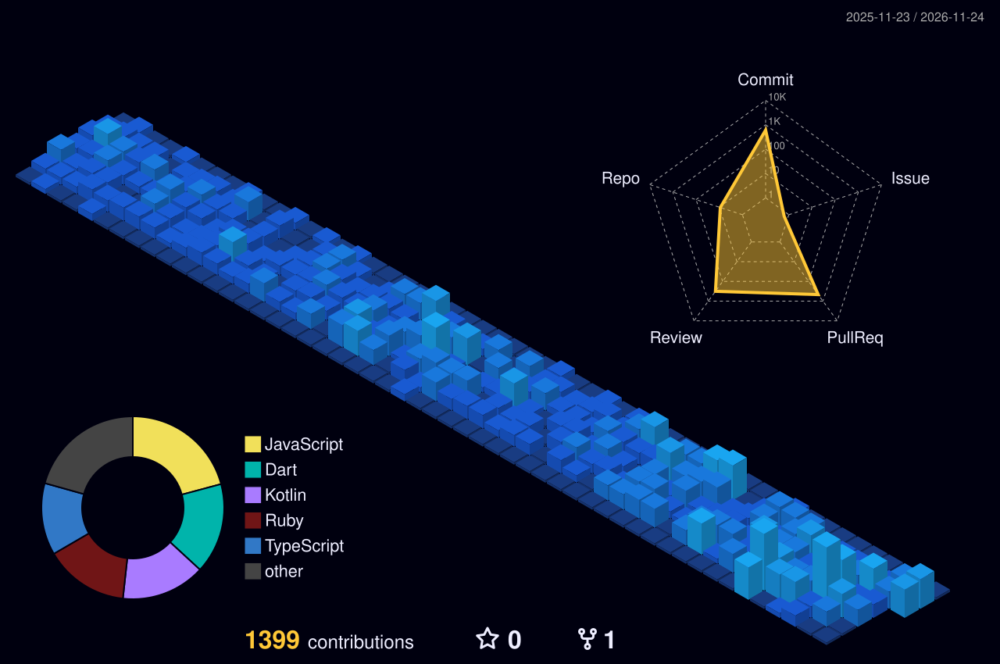

  

  

  
  

---

### 🚀 About me

- 💻 **8+ years** building full-stack web and mobile products, from backend services and APIs to native and cross-platform apps
- 📱 Apps shipped to the **App Store, Google Play, Windows Store and Snapcraft**
- 🏗️ I care about clean architecture, automated tests and CI/CD that let teams ship with confidence
- 🤖 Daily user of **AI-assisted development** (Claude Code, Codex, Copilot, Cursor, MCP)
- 🎮 Game developer at heart: currently building a **roguelite hack-and-slash in Godot 4**
- 🌎 Based in Brazil · 🇧🇷 Portuguese · 🇺🇸 English

---

### 🛠️ Tech stack

**Backend**

  
  
  
  
  
  

**Frontend & Mobile**

  
  
  
  
  
  
  
  

**Databases**

  
  
  

**DevOps & Quality**

  
  
  
  
  
  
  

**Game Dev**

  
  
  
  
  

---

### 📊 GitHub activity

> Most of my professional work lives in private repositories, so it shows up here as anonymous contributions.

  

  

  

  

